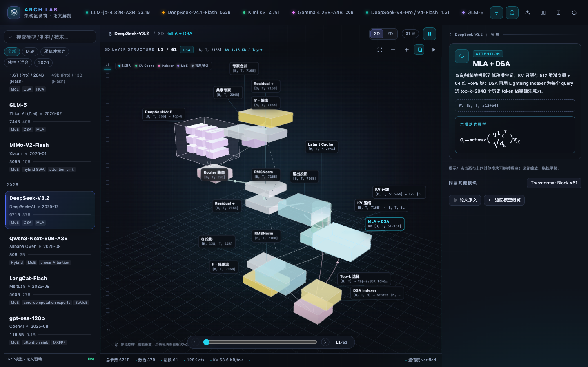

# 架构显微镜 / Arch Lab



**Arch Lab** turns each layer of frontier LLM papers into a rotatable, clickable 3D structural cutaway, with tensor shapes and LaTeX formulas.

把最新大模型论文里的**每一层**展开成可旋转、可点击的 3D 结构剖视：残差主干、Q/KV 投影、MLA latent cache、DSA indexer / top-k、稀疏注意力、MoE 路由与专家，都以带张量形状的 3D 模块呈现；点击模块即可查看论文公式与逐符号解释。原有 2D 宏观 / 层内视图完整保留。

- 插件包：`@powehig/dsh-arch-lab`
- 安装：DSH `plugin_manager install_bundle @powehig/dsh-arch-lab`
- 入口：DSH Web 侧边栏「架构显微镜」图标（`order: 12`）
- 语言：跟随 DSH locale 自动切换中文 / English
- 主题：跟随 DSH 深色 / 浅色主题
- 默认视图：**3D 逐层结构**；工具栏 `3D / 2D` 随时切换，选择会记在 `localStorage`
- 发布：GitHub `PowehiG/dsh-arch-lab` / npm `@powehig/dsh-arch-lab`
- License：MIT（Three.js r128 以 MIT 许可内嵌，见 `vendor/THREE-LICENSE`）

## 3D 逐层结构剖视

中间不是一叠层片，而是**当前这一层本身的 3D 架构图**。左侧层轨和底部滑杆覆盖全部 `1..N` 层；切换层时，3D 场景里的模块、连线、张量形状和公式同步替换。

```
h · 残差流
  └─ RMSNorm ──┬─ Q 投影 ───────────────┐
               ├─ KV 压缩 → Latent Cache → KV 升维 ─┤
               └─ DSA Indexer → Top-k 选择 ─────────┤
                                                    ▼
                                          MLA + DSA 稀疏注意力
                                                    │
                                              输出投影 ──► Residual +
                                                            │
                                                         RMSNorm
                                                            │
                                      Router → 共享专家 / DeepSeekMoE
                                                            │
                                                        专家合并
                                                            │
                                                        Residual + → h′
```

- **模块是真正的 3D 几何体**：投影/注意力是发光 box，KV cache 是圆柱，循环状态是带环的圆柱，专家是 3×3 网格；不同模块类型有固定色板。
- **能看到层内数据流**：主干、分支、残差 skip、top-k 选择、状态更新分别用不同曲率和颜色的管道表示；粒子沿主路径流动（可暂停）。
- **能看到张量形状**：每个模块的 label 直接显示 shape；点击后在右侧检查器显示完整输入/输出形状、说明、公式和符号表。
- **标签会自动避让**：HTML label 会投影到 3D 模块旁，自动避开所有模块 box 和其他 label，并用细引线连回所属模块；不会糊成一团。
- **相机自动取景**：按当前层的包围盒计算 target 和 radius；拖拽旋转、滚轮缩放、`fit` 重置；窗口尺寸变化会重新取景。
- **所有模块可点**：点击 3D 几何体或它的 label 都行；重叠时按“离点击点最近的模块中心”选择，避免被前排盒子挡住。
- **WebGL fallback**：环境不支持 WebGL 时，同一份场景图会降级成纵向模块列表，不丢结构信息；2D 视图也始终可用。

### 以 DeepSeek-V3.2 的 DSA 为例

选中 `DeepSeek-V3.2` 后，第 1 层会展开为 18 个 3D 模块：

1. **主干**：`h → RMSNorm → Residual + → RMSNorm → Residual + → h′`。
2. **Q 分支**：`RMSNorm → Q 投影`，形状 `[B, T, d] → [B, H, T, d_h]`。
3. **MLA KV 分支**：`KV 压缩` 把 K/V 压成 `[B, T, kvLora+rope]` 的 latent；`Latent Cache` 是每个 token 只存一条的圆柱 cache；`KV 升维` 在注意力前还原 K/V。
4. **DSA 稀疏分支**：`DSA Indexer` 用轻量 indexer 为每个 query 估分 `[B,T] → scores [B,T]`；`Top-k 选择` 只保留 `topk` 个 token；随后与 Q、KV 一起进入 `MLA + DSA` 中央注意力。
5. **输出与 MoE**：中央注意力 → `输出投影` → 残差；`RMSNorm` 后进入 `Router 路由`，分到 `共享专家` 与 `DeepSeekMoE` 3×3 专家网格，`专家合并` 后回到残差。

对应公式（点击模块可看完整符号表）：

- Q/KV latent：`c_t = W_DK x_t`，`K_t = W_UK c_t`，`V_t = W_UV c_t`
- DSA 选择：`s_t = Indexer(q_t, k_t)`，`I_t = TopK(s_t, k)`
- 稀疏注意力：`y_t = softmax(q_t K_{I_t}^T / sqrt(d_h)) V_{I_t}`
- MoE：`y = sum_{i in TopK(g_t)} g_i * Expert_i(x)`

> DSA 的 indexer 细节各论文版本略有差异；这里展示的是“轻量 indexer → top-k token 索引 → 精确稀疏注意力”的公开结构，不冒充某篇论文的逐行伪代码。

## 每一层是什么结构

`src/03-data.js` 的纯函数按模型标签推导第 i 层的变体；`src/03b-scene.js` 再把它变成 3D 节点和连线。

| 模型族 | 层序列 | 依据 |
| --- | --- | --- |
| Kimi K3 | 每 4 层 1 层 MLA，其余 KDA | `KDA` + `MLA` |
| Qwen3-Next | 3 层 GDN + 1 层 Gated Attention | `Linear Attention` + `GQA` |
| MiniMax-M1 | 每 8 层 1 层 Full，其余 Lightning | `Lightning` |
| Gemma 4 | 每 6 层 1 层 Global，其余 Local | `local/global attention` |
| Llama 4 | 每 4 层 1 层 Global(NoPE)，其余 Local | `iRoPE` |
| gpt-oss / MiMo | 全层与 SWA 交替 | `sliding window` / `hybrid SWA` |
| DeepSeek-V4 | CSA 与 HCA 交替 | `CSA` + `HCA` |
| DeepSeek-V4.1 | 全层 CSA2 | `CSA2` |
| DeepSeek-V3.2 / GLM-5 | 全层 DSA（MLA latent） | `DSA` |
| DeepSeek-V3 / Kimi K2 / LongCat | 全层 MLA | `MLA` |
| 其余 GQA 模型 | 全层 GQA | `GQA` |

张量形状由 `config` 计算，而不是照抄节点文案：

- `hidden = [B, T, dModel]`
- `q = [B, heads, T, headDim]`
- `kv = [B, kvHeads, T, headDim]`
- `MLA/DSA latent = [B, T, kvLora + ropeDim]`
- `CSA = [B, T/4, latent]`，`HCA = [B, T/128, latent]`
- `Local/SWA = [B, kvHeads, window, headDim]`
- `Linear = [B, heads, headDim, headDim]` 的常数状态
- MoE 路由：`[B, T, experts] → top-k → [B, T, dModel]`

> 这些是按论文公开配置 / 标签推导的形状；论文只给部分字段时用 `?` 或合理默认值，UI 不会把它伪装成官方逐层表。

## 原来的 2D 视图还在

工具栏切到 `2D` 后，行为与上一版一致：

- **宏观结构**：embedding → N×Transformer Block → final norm → LM head；节点带张量形状、参数量和一句话解释。
- **层内结构**：双击带 `×N` 的重复块进入，查看 pre-norm、MLA/GQA/线性注意力、MoE 路由、共享专家、残差的具体数据流。
- 点击任意节点，右侧显示形状、说明、公式；重复块可继续下钻。

2D 和 3D 共享模型数据、检查器、对比、计算器和论文解析，不会出现两套状态。

## 一眼能看到什么

内置 16 个 2025–2026 模型，按发布时间倒序：

| 模型 | 总参 / 激活 | 关键结构 |
| --- | --- | --- |
| DeepSeek-V4.1-Flash | 552B + 196B Engram / 16B decode | Engram 条件记忆、40 层、890 B/token KV |
| DeepSeek-V4-Pro / V4-Flash | 1.6T / 49B；284B / 13B | 61 层、384 专家、CSA/HCA 交替 |
| Kimi K3 | 2.78T / 104B | 93 层、KDA/MLA、NoPE |
| Gemma 4 26B-A4B | 26B / 3.8B | 混合局部/全局注意力 |
| GLM-5 | 744B / 40B | DSA 稀疏注意力、Muon 优化器 |
| MiMo-V2-Flash | 309B / 15B | 混合 SWA、MTP |
| DeepSeek-V3.2 | 671B / 37B | DSA + MLA + DeepSeekMoE |
| Qwen3-Next-80B-A3B | 80B / 3B | 3:1 Gated DeltaNet / Gated Attention |
| LongCat-Flash | 560B / 27B | Zero-computation experts |
| gpt-oss-120b | 116.8B / 5.1B | MXFP4、128 专家 top-4 |
| Kimi K2 | 1.04T / 32B | 384 专家、MuonClip |
| GLM-4.5 | 355B / 32B | 混合专家、MTP |
| MiniMax-M1 | 456B / 45.9B | Lightning Attention |
| Llama 4 Maverick | 400B / 17B | 128 专家、iRoPE |
| DeepSeek-V3 | 671B / 37B | MLA + 无辅助损失负载均衡 |
| LLM-jp-4 32B-A3B | 32.1B / 3.8B | 32B 级 MoE |

每个模型还包含：

- **设计要点**：5–8 张可展开卡片，每张都有中文解释、LaTeX 公式和符号表。
- **参数 / KV 计算器**：改层数、hidden size、专家数、top-k、KV heads，实时估算总参、激活参数、每 token KV 字节数和单层参数量。
- **模型对比**：最多 4 个模型并排，比较参数效率、KV 成本、上下文和结构标签。
- **论文解析**：粘贴 arXiv **PDF / HTML / abs** URL、普通论文页或正文；PDF 会自动转文本，优先使用 arXiv HTML，再退回 PDF / 摘要。自动抽取标题、hidden size、层数、专家数、top-k、上下文和公式，生成可导入的草稿。
- **在线发现**：工具栏刷新按钮会实时搜索最新 arXiv cs.CL 论文与 Hugging Face `text-generation` 模型的 `config.json`；点击“解析”或“导入”即可加入实验室。

## 更新 / 发现最新模型

工具栏的刷新按钮不再是“重新读一遍静态 JSON”。点击它（或打开面板后自动预热）会：

1. 查询 **arXiv API** 最近的 cs.CL 论文，按提交时间倒序，返回标题、摘要、作者、日期、abs/HTML/PDF 链接；
2. 查询 **Hugging Face API** 的最新 + 高赞 `text-generation` 模型，并额外按官方实验室（Baidu、DeepSeek、Qwen、Z.ai、OpenAI、Google、Meta、Mistral、Moonshot、MiniMax 等）和模型家族（ERNIE、DeepSeek、Qwen、Kimi、GLM、MiniMax、Llama、Gemma、gpt-oss、Mistral）定向搜索，过滤 GGUF / 量化 / LoRA / adapter 等衍生仓库，读取公开 `config.json`；
3. 从 config 推导层数、hidden size、heads、KV heads、head dim、专家数、top-k、上下文和词表，生成可直接导入的架构草稿；
4. 在「发现最新模型」弹窗里分别展示论文与模型；论文点“解析”会预填并抓取全文，模型点“导入”会直接进入实验室。

结果在 Host 内存缓存 15 分钟；工具栏刷新图标上的数字表示本次发现的条目数。官方实验室定向查询保证刚发布、但已掉出“最新 60 条”的模型（例如 **Baidu `ERNIE-5.5-Flash-Base`**）仍能被发现。

通过官方 `config.json` + 模型卡导入 ERNIE 5.5 Flash 后，会显示：

- 43 层：**37 层 HCA + 6 层 MLA-DSA**，按 `compress_ratios` 的 `-2` 标记识别；
- **VHA 在每一层 attention 中启用**：3D 场景会出现 `Q Premix`、`Postmix`、`输出门` 节点，attention 标题为 `HCA+VHA` / `MLA-DSA+VHA`；
- 64 query heads、512/256 的层特定 head dim、512 routed experts top-10、1 shared expert、1M ctx；
- 模型卡统计：280B total / 14B activated。网络不可用时会显示 warning，但不会影响内置的 16 个模型和 2D/3D 视图。

> arXiv / Hugging Face 都是公开 API；搜索结果不代表模型质量排名。Hugging Face 侧只提取 `config.json` 的公开字段，总参/激活仍以模型卡为准。

## 交互

| 操作 | 效果 |
| --- | --- |
| 点击左侧模型卡 | 切换模型；3D 场景按新模型重新取景 |
| 工具栏 `3D / 2D` | 切换逐层 3D 剖视 / 原 2D 画布 |
| 3D 画布拖拽 | 旋转视角 |
| 3D 画布滚轮 | 缩放 |
| 点击 3D 模块或 label | 右侧检查器显示完整形状、说明、公式、符号表 |
| 点击空白 | 取消选择 |
| 左侧层轨 / 底部滑杆 / `←` `→` `↑` `↓` | 上一 / 下一层，覆盖全部层 |
| `fit` / 双击空白 / `0` | 重新自动取景 |
| 顶部 `−` / `+` | 缩小 / 放大 |
| 标签按钮 | 显示 / 隐藏模块 label 与引线 |
| 工具栏刷新按钮 | 搜索最新 arXiv 论文 + Hugging Face config，并打开「发现最新模型」 |
| 暂停 / 播放 | 开关数据流粒子 |
| 点击展开设计要点 | 查看该模型的关键公式 |
| 2D 双击 `×N` 重复块 | 进入层内视图 |
| 顶部放大镜 | 搜索模型名、机构、标签、摘要 |
| `All / MoE / Linear / MLA / DSA / MTP` | 结构筛选 |
| 顶部 `?` | 内置帮助 |
| 顶部 `⇄` | 模型对比 |
| 顶部计算器图标 | 参数 / KV 估算 |

## 给 Agent 用：`paper_lab` 工具

Host 半注册了 `paper_lab` 工具，Agent 可以直接抓论文并把结构化 spec 推到面板：

```json
{"action":"fetch","url":"https://arxiv.org/abs/2606.xxxxx","maxChars":80000}
{"action":"publish","spec":{"name":"...","summary":"...","config":{...},"ideas":[...],"stack":[...]}}
{"action":"list"}
{"action":"clear"}
```

- `fetch`：arXiv `abs` URL 会自动尝试 `arxiv.org/html/<id>` 全文；HTML 中的 MathML `alttext` / LaTeX annotation 会转成 `$...$`，供面板里的公式渲染器识别。
- `publish`：写入 Host 内存，`origin: "agent"`；面板每 4.2 秒轮询 `/paper-lab/api/custom`，几秒内出现，带 `AGENT` 标记。
- 发布 spec 的 `stack` 可省略，客户端会按 `config` 自动生成宏观结构；3D 逐层场景会从 `config`、`tags` 和 `stack` 推导。

也可以完全在 UI 内操作：论文解析 → 导入本地模型 → 存 `localStorage`，带 `IMPORT` 标记，可移除。

## 支持的公式子集

渲染器是自带的小型 LaTeX 解析器，不依赖 KaTeX/MathJax，支持：

- 上下标 `x_i^2`、`\sum_{i=1}^{n}`、`\prod`、`\int`
- `\frac{a}{b}`、`\sqrt{x}`、`\left( ... \right)`、`\{ ... \}`
- `\mathrm`、`\mathbf`、`\mathcal`、`\mathbb`、`\text`、`\operatorname`
- `\underbrace{...}_{...}`、`\overbrace{...}^{...}`
- `\dots`、`\cdot`、`\times`、`\approx`、`\le`、`\ge`、`\neq`、`\to`、`\uparrow`、`\downarrow`、`\nearrow`、`\searrow`
- 常用函数名 `\ln`、`\log`、`\exp`、`\max`、`\min`、`\tanh`、`\sin`、`\cos`、`\lim`、`\sup`、`\inf`

3D 场景新增的公式包括：

- 线性注意力：`S_t = α_t S_{t-1} + β_t k_t v_t^T, y_t = S_t q_t`
- CSA/HCA：`K_c = Compress(K; m), y = softmax(Q K_c^T / √d_h) V_c`
- DSA：`I = TopK(Indexer(q,k)), y = softmax(q k_I^T / √d_h) v_I`
- Local/SWA：`y_t = softmax(q_t K_{t-W:t}^T / √d_h) V_{t-W:t}`

不支持 `\begin{aligned}`、`\tag`、`\label`、TikZ；遇到未知命令会显示原始 token，便于发现数据问题。

## 数据与代码结构

```
dsh-arch-lab/
├── package.json          # dsh.bundle.patch + dsh.client 清单；依赖 pdf-parse
├── cordis.patch.yml      # 插入 include:arch-lab
├── host2.js              # Host：/paper-lab/api/* + paper_lab 工具
├── client.js             # 构建产物（浏览器半，含 Three.js，约 832 KB）
├── build.mjs             # 把 src/*.js + vendor/three.min.js 拼成 client.js
├── data/models.json      # 16 个内置模型（约 134 KB）
├── icon.svg              # 侧边栏图标
├── locale/{zh,en}.json   # 插件元数据
├── vendor/
│   ├── three.min.js      # Three.js r128 UMD（MIT）
│   └── THREE-LICENSE
└── src/
    ├── 01-style.js       # 设计系统 CSS + 3D 场景/标签/引线样式
    ├── 02-math.js        # LaTeX 子集解析 + 渲染
    ├── 03-data.js        # 模型归一化、KV 估算、层变体/形状推导、默认结构
    ├── 03b-scene.js      # 纯函数：把某一层变成 3D 节点/边/包围盒
    ├── 04-ui.js          # 旧 3D 甲板、blueprint、2D 画布、检查器、计算器、对比、论文解析
    ├── 04b-scene-ui.js   # 3D 场景（Three.js）、标签布局、拾取、相机
    └── 05-panel.js       # 面板状态、3D/2D 切换、轮询、slot 注册
```

### 模型数据 schema

```ts
{
  id, name, org, released, accent,
  paper: { title, url },
  summary, tags: string[],
  stats: { total, active, layers, context, experts, topK },
  config: { layers, dModel, heads, kvHeads, headDim, experts, shared,
            topK, vocab, context, moeInter, kvLora, ropeDim, kvLayers,
            kvBytesPerToken },
  stack: [{
    id, label, sub, kind, shape, desc, formula,
    vars: [[symbol, meaning]],
    count, inner: [ ...同样结构的子节点 ]
  }],
  ideas: [{ title, body, formula, vars: [[symbol, meaning]] }]
}
```

`kind` 决定节点颜色和图标：`io, norm, attention, moe, ffn, router, expert,
residual, head, repeat, linear, conv, embed, custom`；逐层 3D 场景还引入
`cache, indexer, selector, state`。

3D 不要求 `stack` 里预先写 93 层：`buildLayerInfo(model, i)` 会从 `config`、`tags` 和 `stack` 的重复块推导第 i 层的变体、模块链和张量形状；`buildSceneGraph(model, i)` 再生成 3D 节点坐标、尺寸、连线与包围盒。

## 安装

### 从 npm 安装

在 DSH 中让 Agent 执行：

```text
plugin_manager install_bundle @powehig/dsh-arch-lab
```

也可以用本地目录安装（适合开发）：

```bash
git clone https://github.com/PowehiG/dsh-arch-lab.git
cd dsh-arch-lab
node build.mjs
```

然后把目录路径交给 `plugin_manager install_bundle`。

不要同时安装旧的 `@local/arch-lab-v8` / `@local/arch-lab-v9`：它们注册同一个
`/paper-lab/api` Host 路由，会冲突。安装前先 `remove_bundle` 旧版本。

修改 Host 或 Client 后，**仅重装同名包不会重载已缓存的 ESM 模块**。两种生效方式：

1. 重启 DSH；或
2. 使用新的包名（本版为 `@powehig/dsh-arch-lab`），用 `plugin_manager`
   `remove_bundle` 旧包 + `install_bundle` 新目录。

不要手动改 profile 的 `package.json` / `cordis.patch.yml`，统一走 `plugin_manager`。
`build.mjs` 会从 `package.json` 读取 `name` 写入 ModuleLoader id，所以改名后只需重新构建。

## 验证记录

- `node --check client.js` 通过；`client.js` 约 832 KB（含 Three.js r128）
- 浏览器渲染：16 个模型的 3D 场景全部出 canvas，无 fallback；18 个 DSA 模块、17 个 MLA/CSA 模块、15–17 个线性/局部/全注意力模块
- DSA 逐模块点击：Q / KV 压缩 / Latent Cache / KV 升维 / Indexer / Top-k / 注意力 / 输出投影 / MoE / Router 全部选中正确的检查器与公式
- 每模型抽 4 层（首层、第 2 层、中间层、末层）检查：标签无重叠、无裁切、模块中心不被底部滑杆遮挡
- 响应式：1440×900 / 1180×800 / 980×760 三种尺寸标签均在 stage 内
- 2D 回归：16 个模型宏观/层内渲染、对比、计算器、论文解析/导入、Hybrid 节点检查器全部通过
- WebGL 禁用时：17 个模块的 fallback 列表正常显示
- `paper_lab.publish` → `/paper-lab/api/custom` 可见 → `clear` 清空
- arXiv PDF URL（`/pdf/2610.17959`）→ 优先 arXiv HTML，返回全文而不是 PDF 二进制；无 HTML 时用 `pdf-parse` 抽文本
- 在线发现端点：arXiv 18 条 + Hugging Face 最多 12 条 config 候选；发现弹窗可解析论文或导入模型
- 定向校验：`baidu/ERNIE-5.5-Flash-Base` 出现在发现结果中；导入后按 37 HCA + 6 MLA-DSA 分层，并在每层显示 VHA Q Premix / Postmix / 输出门，统计为 280B total / 14B active

## 已知限制

- 3D 场景一次显示**当前层**，不是把 93 层同时铺在空间里；用层轨/滑杆访问全部层。
- 逐层 CSA/HCA、GDN/GA、KDA/MLA 等是按论文标签推导的规律；若论文实际交错顺序不同，以 `config`/`stack` 为准，可手动修正数据。
- 未公开的 `headDim`、`kvLora`、专家中间维度用 `?` 或合理默认值；3D 会明确显示 `?` 或推导值，不冒充官方逐层表。
- 3D 坐标是为了可读性手工设计的结构示意，不是按真实张量尺寸比例缩放；形状以 label / 检查器为准。
- 论文解析是启发式抽取，不保证还原论文全部结构；导入后可在 JSON 页签手动修正。
- `fetch` 仅允许公网 http(s)，拒绝内网地址；arXiv 偶发反爬会退回 abs 摘要页。
- PDF 解析使用 `pdf-parse`（PDF.js），对扫描版/加密 PDF 可能失败；arXiv 论文优先走 HTML，失败才走 PDF。
- 在线发现依赖 arXiv/Hugging Face 公共 API，限流或网络异常时会降级为内置模型；Hugging Face 的 config 不包含总参/激活与训练细节。
